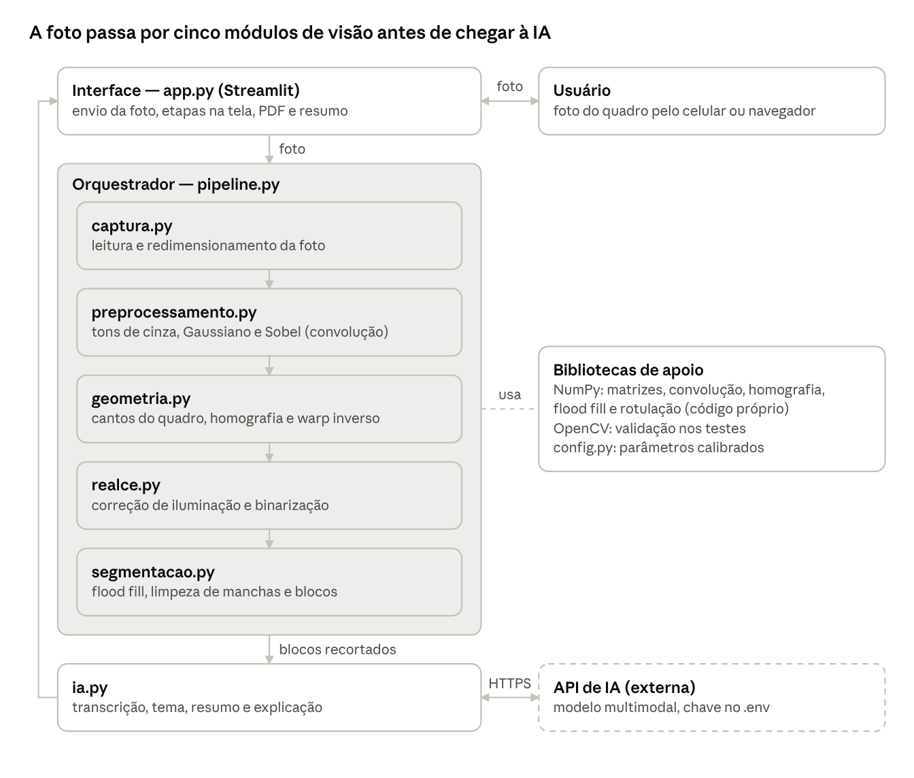

# A3 – Entrega 2: Documentação Técnica do Scanner de Quadro com IA

04/11/2026 (revisada em 11/11/2026, após os testes com fotos reais)

Este documento especifica como o Scanner de Quadro com IA será construído: arquitetura em seis módulos, pipeline de oito etapas, pseudocódigo dos algoritmos centrais e as bibliotecas adotadas. A fundamentação matemática de cada etapa está no relatório da Entrega 1.

| Campo | Informação |
| --- | --- |
| Instituição | UNIFACS |
| Disciplina | Estruturas Matemáticas e Computação Gráfica |
| Professores | Alberlan Lopes, Inácio Borges, Norberto Maciel |
| Semestre | 2026.2 |
| Entrega | 2 — Fase de Engenharia e Documentação Técnica |
| Integrantes | Artur Jansen Almeida de Souza; Davi Jansen Almeida de Souza; Luiz |

## 1. Arquitetura do sistema

O sistema é uma aplicação Python com interface web: a interface recebe a foto, o orquestrador a passa por cinco módulos de visão computacional e, só no fim, o módulo de IA gera o resumo.

{width=100%}

A linha à esquerda é o retorno: a imagem tratada (em PDF) e o resumo voltam para a interface. A API de IA é o único componente externo; sem ela, o sistema ainda entrega a imagem tratada.

| Módulo | Responsabilidade | Entrada | Saída |
| --- | --- | --- | --- |
| app.py | Interface, envio da foto, exibição das etapas e download | Foto do usuário | PDF + resumo na tela |
| pipeline.py | Chama os módulos na ordem e trata erros | Foto | Imagem limpa, blocos e texto |
| captura.py | Leitura e redimensionamento | Arquivo ou câmera | Matriz RGB |
| preprocessamento.py | Tons de cinza, suavização e bordas | Matriz RGB | Cinza e mapa de bordas |
| geometria.py | Cantos, homografia e retificação | Bordas + imagem | Quadro retificado |
| realce.py | Iluminação e binarização | Quadro retificado | Imagem corrigida e binária |
| segmentacao.py | Flood fill, limpeza e blocos | Imagem binária | Imagem limpa e recortes |
| ia.py | Prompts e chamada à API | Recortes | Tema, resumo e explicação |

## 2. Pipeline de captura e tratamento de imagens

A foto passa por oito etapas em sequência; cada uma recebe uma matriz NumPy e devolve outra, o que permite testar e exibir cada etapa isoladamente.

| Etapa | Módulo | Entrada | Operação | Saída | Parâmetros iniciais |
| --- | --- | --- | --- | --- | --- |
| 0. Captura | captura | Arquivo JPG/PNG ou câmera | Leitura e redimensionamento (maior lado = 1600 px) | Matriz RGB M×N×3, uint8 | lado_max = 1600 |
| 1. Tons de cinza | preprocessamento | RGB M×N×3 | f = 0,299R + 0,587G + 0,114B | Cinza M×N | — |
| 2. Suavização | preprocessamento | Cinza M×N | Convolução com Gaussiano 3×3 | Cinza M×N | máscara 3×3 |
| 3. Bordas | preprocessamento | Cinza suavizada | Sobel Gx, Gy e magnitude + limiar | Mapa de bordas binário M×N | limiar_borda = 60 |
| 4. Cantos do quadro | interface + geometria | Foto na tela | O usuário clica nos 4 cantos; os pontos são ordenados (sup-esq, sup-dir, inf-dir, inf-esq) | 4 pontos (x, y) | — |
| 5. Retificação | geometria | RGB + 4 cantos | Monta A h = b, resolve H, warp inverso com interpolação bilinear | Quadro retificado W×H | W/H pela média dos lados |
| 6a. Iluminação | realce | Cinza do quadro retificado | Quadro negro (assimetria γ > 0) é invertido; fundo b em duas passadas de média k×k; f̂ = 255·min(1, f/b) | Cinza corrigida W×H | k = 41 |
| 6b. Binarização | realce | Cinza corrigida | Limiar adaptativo (média m×m − C) | Binária B W×H (1 = escrita) | m = 25, C = 10 |
| 7a. Limpeza | segmentacao | B | Rotulação por flood fill; mantém escrita forte e pingos perto dela; apaga poeira e a faixa da borda | B' limpa | a_min = 25 px; pingo ≥ 4 px; raio = 12 px; faixa = 3% |
| 7b. Blocos | segmentacao | B' | Redução 4×, dilatação mais larga na horizontal, rotulação e retângulos envolventes, ordenados de cima para baixo | Lista de recortes | dilatação 25 × 51 px; tinta forte mínima = 75 px |
| 8. IA | ia | Recortes + imagem limpa | Uma chamada com os blocos em ordem de leitura: transcrição, tema, resumo e explicação | Texto estruturado (JSON) | modelo multimodal; até 8 blocos |
| 9. Exportação | interface | Imagem limpa + texto | Gera PDF e mostra na tela | PDF + resumo | — |

Os parâmetros acima já foram calibrados com 11 fotos reais de quadros (seção 6) e ficam todos em `scanner/config.py`. A calibração final será feita com fotos dos quadros da UNIFACS (branco e negro, ângulos e luzes diferentes). A interface mostra a saída de cada etapa, o que também serve para a demonstração ao vivo.

## 3. Pseudocódigo dos algoritmos centrais

Os nove algoritmos abaixo cobrem o caminho completo da foto ao resumo. Todos os algoritmos de visão (convolução, Sobel, homografia, warp, realce, flood fill e rotulação) foram implementados pelo grupo em NumPy; o OpenCV aparece só nos testes, para conferir os resultados.

### 3.1 Pipeline principal

```
função PROCESSAR_FOTO(arquivo):
    rgb    ← CARREGAR(arquivo, lado_max = 1600)
    cinza  ← TONS_DE_CINZA(rgb)
    suave  ← CONVOLUCAO(cinza, GAUSS_3x3)
    bordas ← SOBEL(suave) > limiar_borda
    cantos ← ORDENAR_CANTOS(CLIQUES_DO_USUARIO(rgb))   // 4 cliques na foto
    H      ← HOMOGRAFIA(cantos, retangulo_destino(cantos))
    quadro ← WARP_INVERSO(cinza, H, W, Hdest)
    claro  ← CORRIGIR_ILUMINACAO(quadro, k = 41)
    B      ← BINARIZAR_ADAPTATIVO(claro, m = 25, C = 10)
    (B, F) ← LIMPAR_MANCHAS(B, a_min = 25, raio = 12)   // F: escrita forte
    blocos ← SEPARAR_BLOCOS(B, F, claro)
    texto  ← RESUMIR_COM_IA(blocos)
    retorne (claro, B, texto)
```

### 3.2 Convolução 2D

```
função CONVOLUCAO(f, w):                     // f: M×N, w: (2a+1)×(2b+1)
    g ← matriz M×N de zeros
    fp ← PREENCHER_BORDA(f, a, b)            // replica as bordas
    para x de 0 até M−1:
        para y de 0 até N−1:
            soma ← 0
            para s de −a até a:
                para t de −b até b:
                    soma ← soma + w[s+a][t+b] · fp[x−s+a][y−t+b]
            g[x][y] ← soma
    retorne g
```

Na implementação, os dois laços internos viram uma soma de fatias deslocadas da matriz (vetorização NumPy), mantendo exatamente a mesma fórmula. Para Sobel, usa-se a versão separável: uma convolução com [1, 2, 1]ᵀ e outra com [−1, 0, 1].

### 3.3 Cantos do quadro

O usuário marca os 4 cantos do quadro clicando na foto, em qualquer ordem. A ordenação abaixo põe os pontos na ordem que a homografia espera. Na primeira versão do protótipo os cantos eram achados automaticamente, mas a moldura quase sempre encosta em outras bordas (pessoa, planta, mesa) e a detecção errava; com os cliques, o resultado é sempre o quadro que o usuário quer, e a matemática avaliada (homografia e warp) é a mesma.

```
função ORDENAR_CANTOS(p):                    // sup-esq, sup-dir, inf-dir, inf-esq
    sup_esq ← ponto com menor x + y
    inf_dir ← ponto com maior x + y
    sup_dir ← ponto com menor y − x
    inf_esq ← ponto com maior y − x
    retorne [sup_esq, sup_dir, inf_dir, inf_esq]
```

### 3.4 Cálculo da homografia

```
função HOMOGRAFIA(origem[4], destino[4]):
    A ← matriz 8×8; b ← vetor 8
    para i de 0 até 3:
        (x, y)   ← origem[i]
        (x', y') ← destino[i]
        A[2i]   ← [x, y, 1, 0, 0, 0, −x·x', −y·x'];  b[2i]   ← x'
        A[2i+1] ← [0, 0, 0, x, y, 1, −x·y', −y·y'];  b[2i+1] ← y'
    se DET(A) ≈ 0: erro "cantos colineares"
    h ← RESOLVER(A, b)                        // eliminação de Gauss
    retorne [[h1, h2, h3], [h4, h5, h6], [h7, h8, 1]]

função RETANGULO_DESTINO(c):
    W ← média(|c1 − c0|, |c2 − c3|)
    Hd ← média(|c3 − c0|, |c2 − c1|)
    retorne [(0,0), (W−1,0), (W−1,Hd−1), (0,Hd−1)]
```

### 3.5 Warp inverso com interpolação bilinear

```
função WARP_INVERSO(f, H, W, Hd):
    Hinv ← INVERSA(H)
    saida ← matriz Hd×W
    para v de 0 até Hd−1:
        para u de 0 até W−1:
            [xw, yw, w] ← Hinv · [u, v, 1]ᵀ
            x ← xw / w;  y ← yw / w
            se (x, y) fora de f: saida[v][u] ← 255; continue
            x0 ← ⌊x⌋; y0 ← ⌊y⌋; dx ← x − x0; dy ← y − y0
            saida[v][u] ← (1−dx)(1−dy)·f[y0][x0] + dx(1−dy)·f[y0][x0+1]
                        + (1−dx)dy·f[y0+1][x0] + dx·dy·f[y0+1][x0+1]
    retorne saida
```

### 3.6 Correção de iluminação e binarização adaptativa

```
função CORRIGIR_ILUMINACAO(f, k):
    se QUADRO_NEGRO(f): f ← 255 − f
    b1 ← CONVOLUCAO(f, MEDIA_kxk)             // 1ª passada: a tinta puxa o fundo para baixo
    b  ← CONVOLUCAO(max(f, b1), MEDIA_kxk)    // 2ª passada: tinta trocada por b1
    retorne 255 · min(1, f / (b + ε))

função QUADRO_NEGRO(f):                      // assimetria dos tons
    μ ← média(f); σ ← desvio_padrão(f)
    γ ← média((f − μ)³) / σ³
    retorne γ > 0

função BINARIZAR_ADAPTATIVO(f, m, C):
    media ← CONVOLUCAO(f, MEDIA_mxm)
    retorne (f < media − C)                  // 1 = escrita
```

A segunda passada tira a escrita da estimativa do fundo: sem ela, uma letra grossa escurece o próprio fundo estimado e sai mais clara do que deveria. Para máscaras grandes (k = 41), a média é calculada com imagem integral (soma acumulada em linhas e colunas), que dá o mesmo resultado da convolução com custo constante por pixel.

**Por que a assimetria e não a média:** a primeira versão tratava como negro todo quadro com média < 100, mas um quadro verde bem iluminado passa de 100, era tratado como branco e não era invertido, e a escrita se perdia. O fundo ocupa a maior parte da imagem e a escrita forma uma "cauda" no histograma: escura no quadro branco (γ < 0) e clara no quadro negro (γ > 0). Nas 12 fotos de teste, os quadros brancos ficaram entre −2,1 e −0,6 e os negros entre +0,9 e +4,6.

### 3.7 Flood fill iterativo

```
função FLOOD_FILL(B, p0, rotulo, R):          // R: matriz de rótulos (0 = sem rótulo)
    pilha ← [p0]
    area ← 0
    enquanto pilha não vazia:
        p ← DESEMPILHAR(pilha)
        se p fora da imagem ou B[p] = 0 ou R[p] ≠ 0: continue   // caso base
        R[p] ← rotulo; area ← area + 1
        para cada q em N4(p): EMPILHAR(pilha, q)                // 4 chamadas
    retorne area
```

Cada iteração corresponde a uma chamada FF(p, V) da recorrência da Entrega 1 (seção 6.2): o teste do caso base é o mesmo, e empilhar os 4 vizinhos equivale às 4 chamadas recursivas. Por isso valem os Teoremas 1 a 3 (terminação, correção e custo 4n + 1).

### 3.8 Rotulação e limpeza de manchas

```
função ROTULAR(B):
    R ← matriz de zeros; L ← 0; areas ← []
    para cada pixel p, linha por linha:
        se B[p] = 1 e R[p] = 0:
            L ← L + 1
            areas[L] ← FLOOD_FILL(B, p, L, R)
    retorne (R, L, areas)

função LIMPAR_MANCHAS(B, a_min = 25, a_pingo = 4, raio = 12):
    (R, L, areas) ← ROTULAR(B)
    para cada componente i de 1 até L:
        forte[i] ← areas[i] ≥ a_min                         // letra ou traço
        pingo[i] ← a_pingo ≤ areas[i] < a_min               // ponto, acento, ":"
    P ← DILATAR(pixels fortes, (2·raio+1)×(2·raio+1))       // região perto da escrita
    para cada componente i:
        manter[i] ← forte[i] ou (pingo[i] e Cᵢ ∩ P ≠ ∅)
    B'[p] ← 1 se R[p] > 0 e manter[R[p]], senão 0
    B'[faixa de 3% junto à borda] ← 0                       // resto da moldura
    retorne (B', pixels fortes)
```

A regra por área sozinha apagava pontos, ":" e pingos de "i". Com o teste de vizinhança, uma componente pequena só fica se estiver perto de escrita forte; manchas de apagador, que ficam soltas, saem. Componentes menores que 4 px (poeira) saem sempre.

### 3.9 Separação em blocos e módulo de IA

```
função SEPARAR_BLOCOS(B, F, claro):
    P ← REDUZIR_MAX(B, 4)                       // 1 se algum pixel do bloco 4×4 é escrita
    D ← CONVOLUCAO(P, UNS_7x13) > 0           // dilatação 25 × 51 px na imagem cheia
    (R, L, _) ← ROTULAR(D)
    blocos ← []
    para r de 1 até L:
        caixa ← 4 · RETANGULO_ENVOLVENTE(pixels com R = r) + margem
        se ÁREA(caixa) ≥ area_min_bloco e TINTA(F, caixa) ≥ 75:   // F: escrita forte
            adicionar RECORTE(claro, caixa) a blocos
    ordenar blocos por (topo, esquerda)
    retorne blocos

função RESUMIR_COM_IA(blocos, claro):
    se |blocos| ≤ 8: imagens ← blocos em ordem de leitura, cada um com "Bloco i:"
    senão:          imagens ← [claro]                     // quadro inteiro
    retorne CHAMAR_MODELO(imagens, "Devolva em JSON: transcrição, tema, resumo em
                          tópicos e explicação didática. Se algo estiver ilegível,
                          escreva [ilegível] em vez de inventar.")
```

A dilatação é mais larga na horizontal porque as letras de uma linha ficam mais próximas entre si do que as linhas entre si: assim cada bloco tende a ser um trecho de conteúdo, não o quadro inteiro. Um bloco só vale se tiver escrita forte suficiente; o que sobra é resto de mancha. A IA recebe tudo numa chamada só, o que é mais barato e mantém a ordem de leitura.

## 4. Especificação das bibliotecas adotadas

O projeto usa sete bibliotecas Python. Os algoritmos avaliados têm implementação própria em NumPy; o pacote `scanner/` não importa o OpenCV, que fica restrito aos testes.

| Biblioteca | Versão mínima | Uso no projeto | Funções principais | Implementado pelo grupo |
| --- | --- | --- | --- | --- |
| Python | 3.10 | Linguagem do protótipo | — | — |
| NumPy | 1.26 | Matrizes da imagem e toda a álgebra linear | ndarray, cumsum (imagem integral), bincount, linalg.inv | Convolução, Sobel, eliminação de Gauss, homografia, warp bilinear, iluminação, binarização, flood fill, rotulação |
| OpenCV (opencv-python) | 4.8 | Só nos testes: referência para conferir as funções próprias | filter2D, GaussianBlur, blur, getPerspectiveTransform, warpPerspective, connectedComponents | Não é usado no pipeline |
| Streamlit | 1.48 | Interface web: envio da foto, visualização das etapas e do resumo | file_uploader, camera_input, image, columns, download_button | — |
| streamlit-image-coordinates | 0.2 | Captura os cliques do usuário nos 4 cantos do quadro | streamlit_image_coordinates | — |
| Pillow | 10.0 | Leitura da foto (com a rotação do celular), redução de tamanho e exportação em PDF | Image.open, ImageOps.exif_transpose, Image.resize, Image.save(format="PDF") | — |
| SDK da API de IA (anthropic) | 0.40 | Chamada ao modelo multimodal para transcrição, resumo e explicação | messages.create com imagem em base64 | Prompts e formato da resposta (JSON) |
| pytest | 8.0 | Testes automáticos | — | Testes comparando as funções próprias com o OpenCV |

**Validação das implementações próprias:** cada função feita pelo grupo tem um teste que compara sua saída com a função equivalente do OpenCV na mesma imagem (por exemplo, nossa homografia contra getPerspectiveTransform, com diferença máxima de 10⁻⁶). Isso comprova que a matemática da Entrega 1 foi implementada corretamente. Hoje são 18 testes, todos passando (`python -m pytest -q`).

**Chave da API de IA:** fica em um arquivo .env fora do repositório. Sem chave ou sem internet, o sistema entrega a imagem tratada e avisa que o resumo não está disponível; o processamento visual não depende da IA.

## 5. Estrutura do repositório e tratamento de erros

O código fica organizado em um pacote por módulo da arquitetura, o que permite dividir o trabalho entre os três integrantes sem conflito.

```
scanner-quadro/
├── app.py                  # interface Streamlit
├── scanner/
│   ├── pipeline.py         # PROCESSAR_FOTO (orquestrador)
│   ├── captura.py          # leitura e redimensionamento
│   ├── preprocessamento.py # cinza, convolução, Gaussiano, Sobel
│   ├── geometria.py        # cantos, homografia, warp inverso
│   ├── realce.py           # iluminação, imagem integral, binarização
│   ├── segmentacao.py      # flood fill, rotulação, limpeza, blocos
│   ├── ia.py               # cliente da API de IA e prompts
│   └── config.py           # parâmetros da seção 2
├── tests/                  # testes contra o OpenCV
├── amostras/               # foto sintética + reais/ (11 fotos com licença livre)
├── docs/                   # entregas, resultados dos testes com fotos reais
├── requirements.txt
├── .env.example            # modelo da chave da API
└── README.md               # instalação e execução (Entrega 3)
```

**Tratamento de erros e casos limite:**

| Situação | Como o sistema reage |
| --- | --- |
| Foto fechada, sem os cantos do quadro | Botão "usar a foto inteira": segue sem correção de perspectiva |
| Cantos quase colineares (det A ≈ 0) | A eliminação de Gauss detecta o pivô nulo e pede ao usuário para marcar os cantos de novo |
| Quadro negro ou verde | Detectado pela assimetria dos tons (γ > 0); a imagem é invertida antes do realce |
| Foto muito escura ou desfocada | Aviso na tela pedindo nova foto; o processamento continua |
| Nenhum bloco de escrita encontrado | Mostra a imagem tratada e informa que não há conteúdo para resumir |
| API de IA indisponível ou sem chave | Entrega a imagem tratada e o PDF; o resumo aparece como indisponível |

**Divisão sugerida para a Entrega 3:** um integrante em preprocessamento.py e geometria.py, outro em realce.py e segmentacao.py, e o terceiro em ia.py, app.py, testes e README.

## 6. Testes com fotos reais e calibração

O pipeline foi testado com 11 fotos reais de quadros com licença livre (Wikimedia Commons), 6 brancos e 5 negros ou verdes, com pessoas na frente, perspectiva, reflexo e fotos fechadas, além da foto sintética. Os resultados de cada foto estão em `docs/resultados-fotos-reais.md`.

| Medida | Resultado |
| --- | --- |
| Tipo de quadro certo (branco × negro) | 12 de 12 |
| Escrita miúda preservada na limpeza | sim (a_min = 25; com 40 ou 60 o texto miúdo some) |
| Blocos na foto sintética | título, fórmulas, coordenadas, composição e desenho separados |
| Tempo por foto | menos de 1 s |

Os testes levaram às mudanças descritas nas seções 3.3 (cantos marcados pelo usuário), 3.6 (assimetria e fundo em duas passadas) e 3.8 (limpeza por vizinhança).

**Limitações conhecidas:** uma pessoa na frente do quadro continua aparecendo no scan; linhas divisórias do quadro podem virar um bloco grande; com escrita muito densa, os blocos ficam grandes. A próxima rodada de testes usará fotos dos quadros da UNIFACS.
